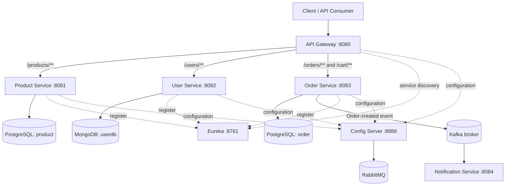
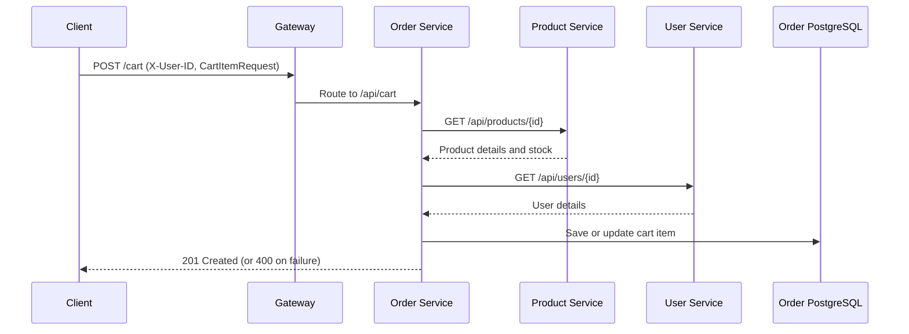
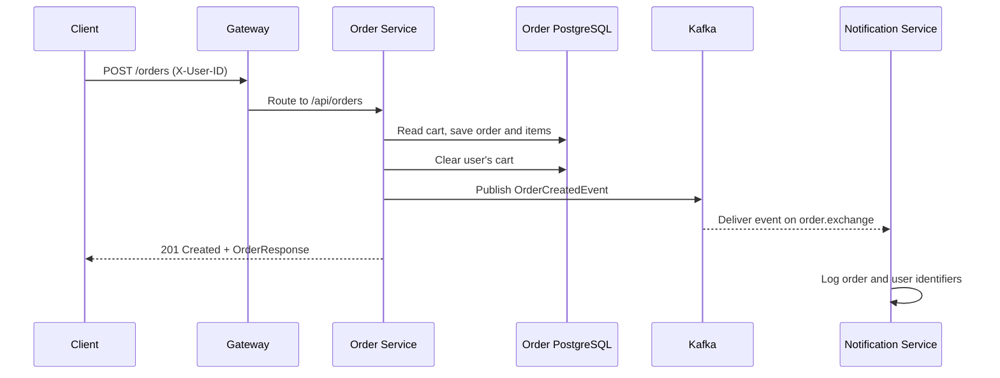

# E-commerce Microservices

A Spring Boot–based e-commerce backend organized as independently runnable services. The repository contains product, user, cart/order, and notification capabilities, together with infrastructure services for API routing, service discovery, and centralized configuration.

> **Repository:** https://github.com/xoUtkarsh/E-commerce-Microservices  
> **Default branch:** `main`

## Table of contents

- [Overview](#overview)
- [Architecture](#architecture)
- [Services and responsibilities](#services-and-responsibilities)
- [Technology stack](#technology-stack)
- [Request and event flows](#request-and-event-flows)
- [API overview](#api-overview)
- [Repository layout](#repository-layout)
- [Prerequisites](#prerequisites)
- [Configuration](#configuration)
- [Running the project](#running-the-project)
- [Observability](#observability)
- [Important implementation notes](#important-implementation-notes)
- [Development](#development)

## Overview

The application separates core e-commerce responsibilities into Spring Boot services:

- **Product service** manages product information, catalog queries, search, and active/inactive product state.
- **User service** manages user profiles and address information.
- **Order service** manages a user's cart and creates orders after consulting the product and user services.
- **Notification service** consumes order-created events from Kafka.
- **API gateway** exposes a common entry point and routes requests to registered services.
- **Eureka server** provides service registration and discovery.
- **Config server** serves shared, service-specific configuration.

The repository also contains Docker Compose definitions for PostgreSQL, pgAdmin, and RabbitMQ, plus separate evaluation Compose files for Prometheus and Loki.

## Architecture

### High-level component view



The diagram represents the intended integration points visible in the source configuration and service code. The Config Server uses the native profile and a filesystem-backed configuration directory. Spring Cloud Bus AMQP is included in the Config Server and some services; the order notification event path itself is implemented with Spring Cloud Stream and the Kafka binder.

### Architectural patterns

- **API Gateway:** routes external paths to internal service paths and uses Eureka service IDs.
- **Service discovery:** services register with Eureka and the gateway routes using `lb://...` URIs.
- **Centralized configuration:** services import configuration from the Config Server.
- **Database per service:** product and order use separate PostgreSQL databases; user uses MongoDB.
- **Synchronous service-to-service calls:** the order service uses HTTP service interfaces to retrieve product and user details.
- **Asynchronous event messaging:** the order service publishes an `OrderCreatedEvent`; the notification service consumes it through Kafka.
- **Resilience:** gateway product routing includes retry, Redis-backed rate limiting, and a circuit breaker. The cart service also has a Resilience4j retry fallback.

## Services and responsibilities

| Module | Default port | Responsibility | Persistence / integration |
|---|---:|---|---|
| `gateway` | 8080 | Entry point; routes product, user, cart, and order requests | Eureka, Config Server, Redis rate limiter, Resilience4j |
| `eureka` | 8761 | Service registry and discovery dashboard | Netflix Eureka |
| `configserver` | 8888 | Serves centralized service configuration | Native filesystem profile; RabbitMQ-backed Spring Cloud Bus dependency |
| `product` | 8081 | Create, list, update, search, fetch, and soft-delete products | PostgreSQL database `product` |
| `user` | 8082 | Create, list, fetch, and update user profiles | MongoDB database `userdb` |
| `order` | 8083 | Cart management, product/user validation, order creation | PostgreSQL database `order`; Kafka producer |
| `notification` | 8084 | Consumes order-created events | Kafka consumer |

### Product service

The product module exposes catalog operations through `/api/products`. Products include fields such as name, category, description, price, image URL, stock quantity, and active state. Listing and ID lookup filter for active products; deletion is implemented as a soft delete by setting the active flag to false. Search accepts a `keyword` query parameter.

### User service

The user module exposes `/api/users`. User records include first name, last name, email, phone, role, and an optional address (street, city, state, country, and zipcode). The configured datastore is MongoDB.

### Order service

The order module exposes cart and order endpoints. Cart operations are associated with a user through the `X-User-ID` request header. Adding a cart item checks the product service for product existence and stock, then checks the user service. Creating an order reads the user's cart, persists an order and its items, clears the cart, and publishes an order-created event.

### Notification service

The notification module declares a Spring Cloud Stream consumer function named `orderCreated`. It consumes JSON messages from the `order.exchange` destination using the Kafka binder and logs the order and user identifiers. The current consumer is a logging implementation; an external email/SMS/push provider is not configured in the inspected source.

### API gateway

The gateway routes:
- `/products/**` to `PRODUCT-SERVICE`, rewriting the path to `/api/products/**`.
- `/users/**` to `USER-SERVICE`, rewriting the path to `/api/users/**`.
- `/orders/**` and `/cart/**` to `ORDER-SERVICE`, rewriting the path to the corresponding `/api/**` endpoint.
- `/eureka/**` to the Eureka web interface.

The product route configures GET retries, a Redis rate limiter keyed by remote hostname, and a circuit breaker with a fallback endpoint at `/fallback/products`.

## Technology stack

The Maven module descriptors declare:

- Java 21
- Spring Boot 4.1.x (the exact patch version differs between modules)
- Spring Cloud 2025.1.x (the exact patch version differs between modules)
- Spring Cloud Gateway (WebFlux)
- Spring Cloud Netflix Eureka
- Spring Cloud Config
- Spring Cloud Stream with Kafka binder
- Spring Cloud Bus AMQP / RabbitMQ dependencies
- Spring Data JPA and PostgreSQL
- Spring Data MongoDB
- Resilience4j circuit breaker and retry
- Redis reactive starter for gateway rate limiting
- Micrometer Prometheus registry and Actuator
- Zipkin/Tracing-related dependencies
- Lombok
- Maven Wrapper scripts in the individual service modules

## Request and event flows

### Add an item to a cart



### Create an order and publish an event



## API overview

The following paths are defined by the controllers. When using the gateway, omit the internal `/api` prefix as shown in the gateway column.

| Capability | Gateway path | Method | Notes |
|---|---|---|---|
| List products | `/products` | GET | Returns active products |
| Create product | `/products` | POST | Body: `ProductRequest` |
| Get product | `/products/{id}` | GET | Active product by ID |
| Update product | `/products/{id}` | PUT | Body: `ProductRequest` |
| Soft-delete product | `/products/{id}` | DELETE | Sets active to false |
| Search products | `/products/search?keyword=...` | GET | Keyword search |
| Product health simulation | `/products/simulate?fail=true` | GET | Test endpoint for simulated failure |
| List users | `/users` | GET | Returns user profiles |
| Create user | `/users` | POST | Body: `UserRequest` |
| Get user | `/users/{id}` | GET | User by ID |
| Update user | `/users/{id}` | PUT | Body: `UserRequest` |
| Get cart | `/cart` | GET | Requires `X-User-ID` |
| Add cart item | `/cart` | POST | Requires `X-User-ID`; body: `CartItemRequest` |
| Remove cart item | `/cart/items/{productId}` | DELETE | Requires `X-User-ID` |
| Create order | `/orders` | POST | Requires `X-User-ID`; creates order from cart |

For cart and order requests, send the user identifier in the `X-User-ID` header. The order service's HTTP clients call the user and product services directly using their internal `/api/users/{id}` and `/api/products/{id}` paths.

## Repository layout

```text
E-commerce-Microservices/
├── configserver/       # Centralized configuration server
├── eureka/             # Eureka discovery server
├── gateway/            # API gateway and route filters
├── notification/       # Kafka order-event consumer
├── order/              # Cart and order domain
├── product/            # Product catalog domain
├── user/               # User profile domain
├── evaluate-loki/      # Loki evaluation/deployment Compose file
├── evaluate-prometheus/# Prometheus evaluation/deployment Compose file
└── docker-compose.yml  # PostgreSQL, pgAdmin, RabbitMQ
```

Each application module has its own Maven `pom.xml`, `mvnw` / `mvnw.cmd` wrapper scripts, and `src/main` source tree.

## Prerequisites

Install or provide:

- JDK 21
- Docker Engine and Docker Compose
- Git
- Maven (optional if using each module's Maven Wrapper)
- MongoDB for the user service
- Kafka broker for order event publishing and notification consumption
- Redis for the gateway's configured rate limiter

PostgreSQL, pgAdmin, and RabbitMQ are defined in the root Compose file. Kafka, MongoDB, and Redis are not defined in that root Compose file and must be started separately or supplied by your environment.

## Configuration

Configuration is split between each service's local `application.yaml` and the Config Server's files under `configserver/src/main/resources/config/`.

| File | Purpose |
|---|---|
| `configserver/src/main/resources/application.yaml` | Config Server port, native profile, config search location, RabbitMQ connection |
| `configserver/src/main/resources/config/gateway-service.yml` | Gateway port, actuator/tracing, circuit-breaker settings |
| `configserver/src/main/resources/config/product-service.yaml` | Product PostgreSQL, service port, Eureka, management and logging |
| `configserver/src/main/resources/config/user-service.yaml` | MongoDB, service port, Eureka, management and logging |
| `configserver/src/main/resources/config/order-service.yaml` | Order PostgreSQL, Kafka producer binding, service port, Eureka, resilience and logging |

### Environment variables

The product and order configuration refer to database credentials through:

- `DB_USER`
- `DB_PASSWORD`

Set these in the environment in which the respective services run. Do not commit real credentials.

The root Compose file currently declares development defaults for PostgreSQL and pgAdmin. Replace those defaults with secure local values before using the stack outside a disposable development environment.

### Local configuration that needs attention

The Config Server's native search location currently points to a machine-specific Windows directory. Update `spring.cloud.config.server.native.search-locations` to the repository's actual `configserver/src/main/resources/config` directory (or another valid configuration directory) on your machine.

Several service configuration files use `localhost` for dependencies. This is appropriate only when those dependencies are reachable on the host at the configured ports. If services run inside containers, use the relevant Compose service/container DNS names and ensure all services share a Docker network.

## Running the project

### 1. Start the infrastructure in the root Compose file

From the repository root:

```bash
docker compose up -d
```

This starts:
- PostgreSQL on `localhost:5432`
- pgAdmin on `http://localhost:5050`
- RabbitMQ AMQP on `localhost:5672`
- RabbitMQ management UI on `http://localhost:15672`

The Compose file defines named volumes for PostgreSQL and pgAdmin data.

### 2. Start the external dependencies

Start MongoDB, Kafka (with its required coordination/controller configuration), and Redis separately. The checked-in root Compose file does not define these services.

The application configuration expects:
- MongoDB at `localhost:27017`, database `userdb`
- Kafka at `localhost:9092`
- Redis reachable by the gateway's Redis auto-configuration

### 3. Configure and start the Config Server

First correct the native configuration search path in `configserver/src/main/resources/application.yaml`. Then run:

```bash
cd configserver
./mvnw spring-boot:run
```

On Windows, use `mvnw.cmd spring-boot:run`.

The Config Server listens on port `8888`.

### 4. Start Eureka

In a separate terminal:

```bash
cd eureka
./mvnw spring-boot:run
```

The Eureka dashboard is available at `http://localhost:8761`.

### 5. Start the business services

Run each module in a separate terminal:

```bash
cd product && ./mvnw spring-boot:run
cd user && ./mvnw spring-boot:run
cd order && ./mvnw spring-boot:run
cd notification && ./mvnw spring-boot:run
```

Use separate terminals; do not chain these commands in a single shell session. The configured ports are 8081, 8082, 8083, and 8084 respectively.

### 6. Start the gateway

```bash
cd gateway
./mvnw spring-boot:run
```

The gateway listens on port `8080`. Requests can then be sent through the gateway paths in the [API overview](#api-overview).

### Build a module

From any module directory:

```bash
./mvnw clean package
```

On Windows:

```bat
mvnw.cmd clean package
```

## Observability

The services include Spring Boot Actuator and Micrometer-related dependencies. Several service configurations expose all actuator endpoints and enable tracing sampling. The gateway configuration includes circuit-breaker health details and tracing sampling.

The repository also contains:
- `evaluate-prometheus/docker-compose.yaml`
- `evaluate-loki/docker-compose.yaml`

These are separate evaluation Compose files; inspect and start them independently if you want to evaluate the monitoring/logging setup. The main Compose file does not start Prometheus or Loki.

## Important implementation notes

The following points are worth understanding before treating this as a production-ready deployment:

1. **The project is split across independent Maven applications.** There is no root Maven aggregator POM; build and run the modules individually.
2. **Dependency versions are not fully aligned.** The POMs declare Spring Boot 4.1.0 and 4.1.1, and Spring Cloud 2025.1.2 and 2025.1.3 across modules. Keep the Spring Boot / Spring Cloud compatibility matrix in mind when upgrading.
3. **Config Server path is machine-specific.** The checked-in native search path references a Windows user directory and must be changed on another machine.
4. **Infrastructure coverage is incomplete in the root Compose file.** Kafka, MongoDB, and Redis are referenced by application configuration or dependencies but are not started by the root Compose file.
5. **Database provisioning is not automated.** The Compose file starts a PostgreSQL server but does not create the separate `product` and `order` databases. Create them before starting the respective services.
6. **Cart item pricing is currently hard-coded.** The cart service assigns a fixed price rather than using the product price returned by the product service. Order totals are therefore not yet derived from live product prices.
7. **Stock is checked but not reserved/decremented.** The cart service verifies available stock but the inspected order flow does not update product inventory.
8. **Order publication is not transactionally coordinated with persistence.** The order is saved and the cart is cleared before the event is sent. Consider an outbox pattern and idempotent consumers for reliable production messaging.
9. **Gateway JWT authentication is not active.** The `JwtAuthFilter` class is commented out as a Spring component, and its current implementation checks only for a Bearer header prefix rather than validating a token. Do not treat it as working authentication.
10. **Gateway Redis rate limiting needs Redis.** The gateway config declares a Redis rate limiter, but Redis is not part of the root Compose file.
11. **The notification consumer currently logs events only.** No mail, SMS, or push delivery implementation is present in the inspected consumer.
12. **Development configuration contains weak/default credentials.** Replace development passwords, avoid committing secrets, and use environment-specific configuration for deployment.

## Development

Suggested workflow:

1. Make changes inside the service that owns the relevant domain.
2. Keep service APIs and event payloads explicit; update the corresponding DTOs and consumers when contracts change.
3. Run the affected module's tests with `./mvnw test`.
4. Build the affected module with `./mvnw clean package`.
5. Verify service registration in Eureka and gateway routing through port 8080.
6. For order-event changes, verify both the Kafka producer binding and the notification consumer binding.

## License

No license file or license declaration was present in the repository at the time this README was prepared. Add a license file if you intend to specify reuse and distribution terms.
